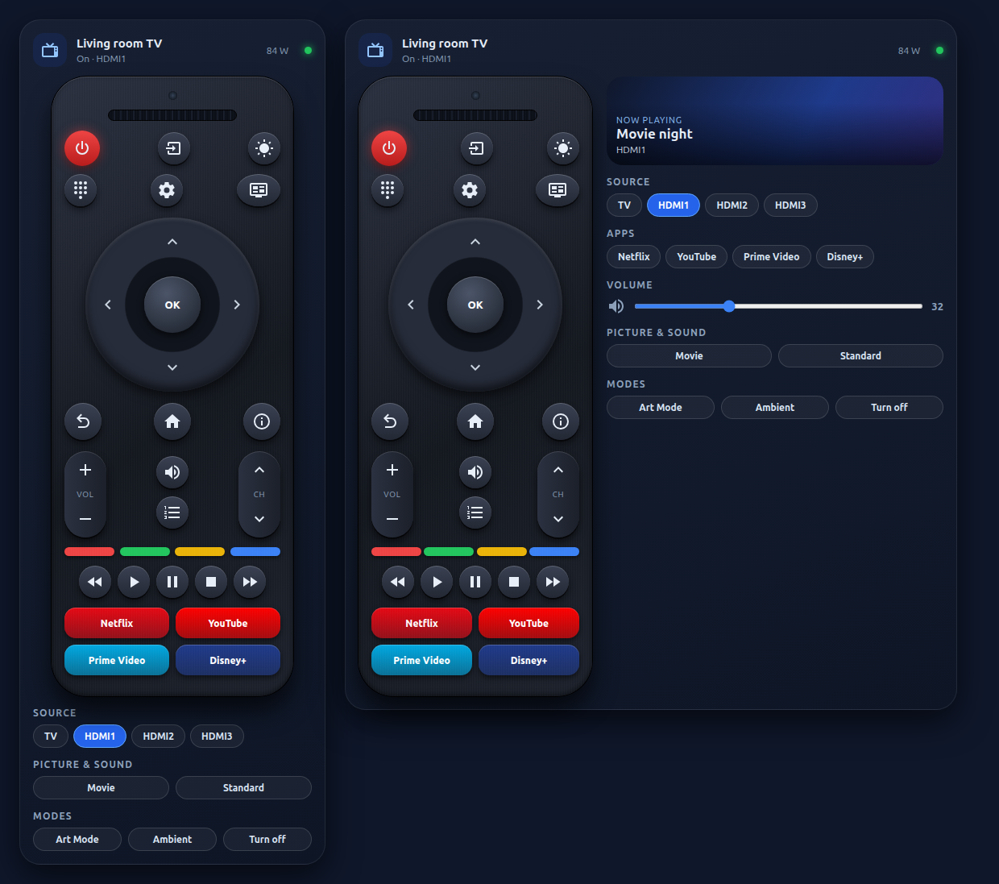

# Samsung TV Remote Card

[](https://my.home-assistant.io/redirect/hacs_repository/?owner=Simonz82&repository=ha_tv_samsung&category=plugin)

Samsung-style remote control card for Home Assistant, for Tizen TVs (`samsungtv_smart` or the core `samsungtv` integration). No dependencies, vanilla JS, visual editor, IT/EN texts following the Home Assistant language.



*(Screenshot rendered with sample data.)*

## Features
- Phone (narrow card): vertical "real remote" look. Tablet/desktop (>= 600 px): remote plus side panel (now playing, sources, apps, volume slider, picture/sound mode, Art Mode, Ambient). Force it with `layout: remote | panel`.
- D-pad, OK, Back/Home/Info/Menu/Guide/Source, number pad pop-up, VOL and CH rockers, mute, colour keys, transport, app tiles.
- With the TV off or unavailable every key is disabled except Power.

## Installation (HACS)
1. Click the button below to open the repository in HACS:

   [](https://my.home-assistant.io/redirect/hacs_repository/?owner=Simonz82&repository=ha_tv_samsung&category=plugin)

   Manual method: HACS > three dots > **Custom repositories**.
2. Repository `https://github.com/Simonz82/ha_tv_samsung`, type **Dashboard** (Lovelace). Add.
3. Search "Samsung TV Remote Card", download, reload the browser.

Manual: copy `samsung-tv-remote-card.js` to `/config/www/samsung-tv-remote-card/` and add the resource `/local/samsung-tv-remote-card/samsung-tv-remote-card.js` (type `module`).

## Configuration
> Since 1.0.1 the card type is `custom:shc-samsung-tv-remote-card` (unique name, no clash with other Samsung remote cards). The old `custom:samsung-tv-remote-card` still works as an alias unless another card already uses that name; if so, switch your YAML to the new type.

```yaml
type: custom:shc-samsung-tv-remote-card
entity: media_player.tv          # required
name: Living room TV             # optional
remote_entity: remote.tv         # optional: send keys through remote.send_command
power_entity: sensor.tv_plug_power  # optional: shows watts
turn_on_script: script.tv_on     # optional: used instead of media_player.turn_on
layout: auto                     # auto | remote | panel
show_picture: true               # picture/sound mode, shown only if the TV exposes the lists
show_sound: true
show_art: true                   # only if art_mode_status exists
show_ambient: true
sources: [TV, HDMI]              # default: source_list attribute
apps:                            # default: Netflix, YouTube, Prime Video, Disney+
  - { name: Netflix, color: "#e50914" }
  - { name: Plex, app_id: "3201512006963", color: "#e5a00d" }
  - { name: HDMI 2, source: HDMI2, color: "#334155" }
```
An app is launched with `select_source` when it is in `source_list` (or `source` is set), otherwise with `media_player.play_media` (`media_content_type: app`, `app_id` or name).

## Services used
`media_player.turn_on/turn_off/volume_up/volume_down/volume_mute/volume_set/media_play/media_pause/media_stop/select_source/select_sound_mode/play_media (send_key, app)`, `samsungtv_smart.select_picture_mode`, `samsungtv_smart.set_art_mode`.

## Italiano
Card telecomando in stile Samsung per TV Tizen. Su telefono mostra il telecomando verticale, su tablet/desktop affianca il pannello con media, sorgenti, app, volume e modalita. Installazione da HACS: pulsante My Home Assistant in cima alla pagina, oppure a mano Repository personalizzati > `https://github.com/Simonz82/ha_tv_samsung` > tipo Dashboard. Configurazione come sopra; con TV spenta e' attivo solo il tasto di accensione.

La vecchia card YAML (basata su `tv-card`) e' nella cartella [`legacy/`](legacy/).

## ☕ Vuoi darmi una mano?

Il contenuto di questa pagina è completamente gratuito e lo scopo non è certamente fare soldi. Se vuoi darmi una mano per le spese e il tempo perso, ecco alcuni modi:

| | |
|---|---|
| [](https://ko-fi.com/C0C713VTGJ) | Offrimi un caffè su Ko-fi |
| [](https://www.paypal.com/paypalme/simongmail) | Una donazione libera su PayPal |
| [](https://amzn.to/3XWWTgz) | Fai i tuoi acquisti Amazon partendo da questo link |

**Canali Telegram:**

| | |
|---|---|
| [](https://t.me/Home_Assistant_News) | Notizie dedicate a Home Assistant |
| [](https://t.me/offerte_domotica_ita) | Offerte sui prodotti di domotica |

---

Sviluppato e curato da [Simonz82](https://t.me/Simonz82) · © 2026
